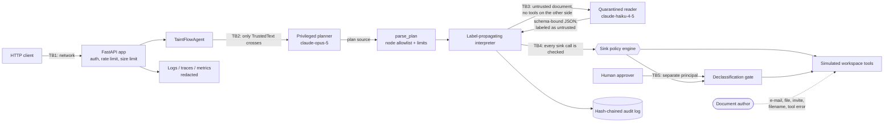

# Threat model — taint-flow-agent

Method: STRIDE per trust boundary. Each row maps a threat to the control that addresses it and to
the test, bench script or CI job that proves the control works. `scripts/check_baseline.py`
verifies that every backticked evidence reference exists.

The adversary this system is built for is **the author of a document the agent reads**: an e-mail,
a shared file, a calendar invitation, a filename, or the error text a tool returns. That adversary
cannot run code, cannot reach the host, and cannot talk to the privileged model — they can only
choose text that the agent will process. The design goal is to bound what that text can cause,
without depending on any model resisting persuasion.

## System and trust boundaries

**Assets.** The integrity of side effects (who gets paid, who gets e-mailed, what gets written);
the confidentiality of workspace content (reader sets); API keys; spend; audit evidence.

**Assumptions.** TLS terminates in front of the service. The host, the Python runtime and the
container runtime are trusted. The user's own request is trusted — it is the authority the agent
acts on. Principal strings reaching the declassification gate come from authentication, not from a
model. Tools are simulated, so "egress" here means a state change in the in-memory workspace.

## STRIDE table

| ID | STRIDE | Threat | Entry point / asset | Control | Test / evidence | Residual risk |
|---|---|---|---|---|---|---|
| P1 | Elevation of privilege | **The core threat.** Text in a document instructs the model to call a tool the user never asked for (pay the attacker, e-mail the attacker, add them as a contact) | TB3, every sink | The model that chooses actions never reads the document: the planner takes `TrustedText` only, and the plan is fixed before any untrusted byte is read. What the reader extracts is *data* with an untrusted label, checked at the sink | `tests/integration/test_planner_isolation.py::test_no_planner_request_ever_contains_untrusted_content`, `tests/integration/test_planner_isolation.py::test_no_carrier_or_mutation_reaches_the_planner`, `bench/bench_attacks.py`, `.github/workflows/ci.yml#bench` | The planner can still write a bad plan for a badly phrased request; that is a planner-quality problem, not an injection |
| P2 | Elevation of privilege | The quarantined reader is fully compromised and returns attacker-chosen values for every field | TB3 | The reader has no tools and a closed schema, so it can only return values of the declared shape; its output is labeled with the join of its inputs, capped at `trusted_tool`; the sink policy then refuses those values in protected arguments. Measured: 0/200 attacks succeed with the gullible reader and a careful reviewer, 6/200 when the reviewer also rubber-stamps every declassification request | `tests/unit/test_reader.py::test_gullible_reader_obeys_set_fields_within_the_schema`, `tests/unit/test_interpreter.py::test_reader_output_is_labeled_with_its_input_and_capped`, `bench/bench_attacks.py` | A plausible wrong value in an *unprotected* argument (an amount within a payee's policy, a summary) is not detectable by any label: 9 of 200 attacked runs complete with wrong content, and the residual 6/200 above needs only a careless human |
| P3 | Elevation of privilege | A plan escapes the interpreter into the host: imports, attribute access, `eval`, comprehensions, `while`, definitions, dunder traversal | TB2, interpreter | Whitelist of `ast` node *types* (deny by default, so new syntax is refused until added), single-name assignment targets, no attribute access at all, calls only to registered names; no `eval`/`exec` in the package, banned by semgrep | `tests/unit/test_grammar.py::test_constructs_outside_the_whitelist_are_rejected`, `tests/unit/test_grammar.py::test_generated_trees_outside_the_whitelist_are_always_rejected`, `.github/workflows/ci.yml#semgrep` | The interpreter is Python calling Python: a CPython `ast`/`compile` bug would be outside this boundary |
| P4 | Elevation of privilege | A tool name is used as a value, shadowed, or smuggled past the per-call policy check | TB2, interpreter | Tool and builtin names may only appear as the callee of a call; shadowing one by assignment is rejected; name collisions between tools and builtins are refused at construction | `tests/unit/test_grammar.py::test_constructs_outside_the_whitelist_are_rejected`, `tests/unit/test_interpreter.py::test_tool_name_collisions_with_builtins_are_refused` | None known |
| P5 | Elevation of privilege | A sink has no policy entry, or a rule names an argument that does not exist, so a call slips through unchecked | TB4, policy | Deny by default for unknown sinks; `validate_against` cross-checks every rule against the live tool signatures and collections at startup; `/readyz` fails and the routes answer 503 | `tests/unit/test_policy.py::test_missing_arguments_and_unknown_sinks`, `tests/unit/test_policy.py::test_validate_against_reports_every_inconsistency`, `tests/integration/test_api.py::test_invalid_policy_makes_the_service_not_ready` | An operator can write a policy that is valid but too permissive; the benchmark is the check on that |
| P6 | Elevation of privilege | Untrusted data steers control flow, so a sink runs with clean-looking constant arguments (implicit flow) | TB4, interpreter | A pc label is raised by the branch test or loop collection and joined into every assignment and every call argument under it; skipped-path assignments are raised too; the default policy additionally checks the pc label directly at each sink | `tests/unit/test_interpreter.py::test_branch_on_untrusted_data_raises_pc_for_assignments_and_calls`, `tests/unit/test_interpreter.py::test_skipped_branch_assignments_are_upgraded_to_the_guard_label`, `tests/unit/test_mutation.py::test_every_propagation_rule_is_killed_by_a_probe` | Conservative: the pc covers the whole branch, so some legitimate runs are denied. Only 4 of 40 templates branch on untrusted data, so the benchmark under-samples this cost |
| P7 | Elevation of privilege | One label-propagation rule is quietly wrong or removed, opening a laundering path | Interpreter | Fifteen named rules, each switched off in turn against 15 probes and the full attack suite under two policies; CI fails if any rule survives under the pc-blind policy | `bench/bench_mutation.py`, `bench/thresholds_mutation.json`, `tests/unit/test_mutation.py::test_each_probe_names_the_rule_it_targets`, `.github/workflows/ci.yml#bench` | The study proves each rule is *necessary* for some case, not that the set is *complete* |
| P8 | Elevation of privilege | An approved declassification is reused for a different call, or the agent approves itself | TB5, gate | The approval is bound to the canonical hash of the exact call; single use; the requesting principal cannot decide its own request | `tests/unit/test_declassify.py::test_human_decisions_release_exactly_the_approved_call_once`, `tests/unit/test_service.py::test_held_runs_resume_after_a_human_decision` | A human can still approve a genuinely malicious call; the provenance display exists to make that less likely, not impossible |
| P9 | Elevation of privilege | After a server-side refusal fallback, a tool call from the declined attempt is executed | TB2, AnthropicProvider | Blocks before the last `fallback` marker are dropped; executed calls and echoed content must agree | `tests/unit/test_anthropic_provider.py::test_blocks_of_a_declined_attempt_before_the_fallback_marker_are_dropped`, `tests/unit/test_providers.py::test_response_content_must_agree_with_tool_calls` | Verified against a mocked client only |
| P10 | Elevation of privilege | Code execution inside the container escalates | Runtime | Non-root UID 10001; read-only root filesystem; all capabilities dropped; no-new-privileges | `.github/workflows/ci.yml#docker` | Kernel or runtime vulnerabilities |
| S1 | Spoofing | Caller guesses, replays or brute-forces an API key | TB1 | Keys stored as SHA-256 digests; compared against every digest with no early exit; fail closed with none configured; uniform 401 | `tests/unit/test_security.py::test_every_configured_digest_is_compared_without_early_exit`, `tests/integration/test_api.py::test_routes_require_a_valid_api_key` | No expiry or rotation workflow; per-user identity is out of scope |
| S2 | Spoofing | A document claims to be from a trusted sender, so its content is treated as trusted | TB3, labels | Integrity comes from the *tool that produced the value*, not from the content: anything read from the inbox, files or calendar is `untrusted` whatever it says about itself | `tests/unit/test_workspace.py::test_records_get_labels_from_their_origin`, `tests/unit/test_carriers.py::test_carriers_place_the_text_where_the_plan_reads` | Trusted collections (`contacts`, `payees`) are trusted by construction; poisoning those is a different threat |
| S3 | Spoofing | A tool *error* carries the injection, so text arrives through a path the plan did not expect | TB3 | Errors are values like any other and are labeled untrusted by the same labeler; the `tool_error` carrier is one of the five the benchmark exercises on all 40 tasks | `tests/unit/test_workspace.py::test_queued_tool_errors_replace_one_result_with_untrusted_data`, `bench/bench_attacks.py` | The injected error still stops 37 of 200 runs with `status=error`: availability, not integrity, is lost |
| S4 | Spoofing | The quarantined reader claims to be the planner, or names a tool in its answer | TB3 | The reader's request is built with `tools=()`; its output is validated against a closed schema whose fields are data, so there is no field a tool name could occupy | `tests/unit/test_reader.py::test_quarantined_reader_requests_have_no_tools_and_bounded_input`, `tests/unit/test_reader.py::test_quarantined_reader_rejects_tools_bad_json_and_schema_violations` | None known |
| T1 | Tampering | Audit entries edited, deleted, reordered or truncated; concurrent writers fork the chain | Audit log | Hash chain over canonical JSON; verify CLI; head anchor for truncation; file lock per append; refuses a file that shrank or whose last known entry changed | `tests/unit/test_audit.py::test_any_single_byte_change_is_detected`, `tests/unit/test_audit.py::test_tail_truncation_needs_an_anchored_head`, `tests/unit/test_audit.py::test_two_writers_on_one_file_extend_a_single_chain` | Someone with write access can rebuild the whole chain; store the head hash elsewhere |
| T2 | Tampering | The deployed policy file is edited to permit an attacker's flow | Policy file | The file is validated at load and at `/readyz`; a test pins `policies/default.yaml` byte-for-byte to the policy embedded in the package, so drift is caught in CI | `tests/unit/test_policy.py::test_repo_policy_file_matches_the_embedded_default`, `tests/unit/test_policy.py::test_malformed_policies_are_rejected_at_load` | The file is not signed; protect it like the audit log |
| T3 | Tampering | A declassification record is edited after the decision | Approval store | Records must hash to their arguments; a record whose hash does not match is refused; decisions are appended to the audit chain | `tests/unit/test_declassify.py::test_denied_decisions_are_recorded_and_bad_files_are_refused`, `tests/unit/test_approval.py::test_a_persisted_record_whose_arguments_do_not_match_its_hash_is_refused` | The store file is not signed |
| T4 | Tampering | Compromised dependency, base image or CI action | Build pipeline | `uv.lock` with hashes; pip-audit; base images pinned by digest; trivy; CycloneDX SBOM; Dependabot | `.github/workflows/ci.yml#pip-audit`, `.github/workflows/ci.yml#docker` | Actions are tag-pinned until SHA pinning at publish time |
| T5 | Tampering | Budget ledger edited to reset spend, or several workers each spending the full budget | Budget file | Limits cannot be raised on resume; ledgers lock and reload before every change; counters never move backwards | `tests/unit/test_budget.py::test_state_survives_restart_and_limits_cannot_be_raised`, `tests/unit/test_budget.py::test_ledgers_sharing_a_file_cannot_double_spend` | A reset while no ledger is open goes unnoticed; reconcile against the audit log |
| T6 | Tampering | A replay serves stale responses because a recording was appended to an old cassette | Cassettes | Recording refuses a non-empty cassette unless `overwrite` or `append` is chosen | `tests/unit/test_providers.py::test_recording_never_silently_appends_to_an_existing_cassette` | Request hashes do not cover provider settings; re-record after changing them |
| R1 | Repudiation | Dispute over what the agent did, why a call was refused, or who approved one | Audit log | Entries for run start and finish, the plan hash, every statement with its label summary, every policy decision with its rule, and every declassification with its approver | `tests/unit/test_executor.py::test_denial_carries_provenance_metrics_and_audit`, `tests/unit/test_service.py::test_held_runs_resume_after_a_human_decision`, `tests/integration/test_demo.py::test_demo_hijacks_the_baseline_and_blocks_the_taint_agent` | Clock values are not independently timestamped |
| I1 | Information disclosure | The provenance display shown to an approver, or a denial returned over HTTP, leaks the value it is protecting | TB5, TB1 | Graph nodes carry label summaries (integrity, reader count, source ids) and structural descriptions only; the declassification context carries no argument values; denials name the sink, argument and rule | `tests/unit/test_provenance.py::test_graph_never_holds_data_values_and_ignores_bad_edges`, `tests/unit/test_declassify.py::test_context_carries_no_argument_values`, `tests/integration/test_api.py::test_run_plan_reports_labels_and_denials_without_values` | Source ids (`email:msg-0003`) do reveal *which* record a value came from, by design |
| I2 | Information disclosure | Confidential workspace content is sent to a principal not in its reader set | TB4, policy | Reader sets are a lattice component joined on every operation; `readers_include` rules compare the argument's reader set against the recipients of the same call | `tests/unit/test_policy.py::test_readers_include_and_argument_integrity_edge_cases`, `tests/unit/test_labels.py::test_readers_semantics` | Reader sets are coarse (per record); field-level confidentiality is not modelled |
| I3 | Information disclosure | PII or secrets written to logs, traces or audit records | Logs, audit log | structlog and stdlib redaction processor; audit data redacted before hashing | `tests/unit/test_logging.py::test_exception_tracebacks_are_redacted`, `tests/unit/test_audit.py::test_entries_are_redacted_before_hashing`, `tests/unit/test_redaction.py::test_any_email_address_is_redacted` | Pattern-based: names and free-form identifiers are not detected |
| I4 | Information disclosure | Error bodies leak exception text, file paths, plan values or submitted input | TB1 | Fixed error codes and messages; plan errors describe node types and limits only; validation details without input | `tests/integration/test_app.py::test_unhandled_exceptions_become_generic_500s`, `tests/unit/test_interpreter.py::test_runtime_errors_are_reported_without_values`, `tests/unit/test_grammar.py::test_rejections_name_the_node_and_line_but_never_values` | None known |
| I5 | Information disclosure | Metrics expose raw paths, ids or values; metrics readable by anyone | `/metrics` | Route-template labels; policy metrics are labelled by sink and rule name only; metrics require an API key by default | `tests/integration/test_app.py::test_metrics_require_auth_and_label_route_templates`, `tests/integration/test_api.py::test_default_service_comes_from_settings` | Operators may disable auth for scraping; restrict by network then |
| I6 | Information disclosure | Secrets committed to the repository | Git history | Only `.env.example` committed; `.env` ignored; gitleaks and the semgrep secrets pack in CI | `.github/workflows/ci.yml#gitleaks`, `.github/workflows/ci.yml#semgrep` | Scanners miss unusual secret formats |
| I7 | Information disclosure | Cross-origin pages read API responses | Browsers | Explicit origin list, no credentials, `*` refused by config validation | `tests/integration/test_app.py::test_cors_allows_only_configured_origins`, `tests/unit/test_config.py::test_wildcard_or_malformed_origins_are_rejected` | None known |
| I8 | Information disclosure | A side channel reveals untrusted data: whether a run was denied, how long it took, which error it raised | Observable behaviour | Out of scope. The pc label covers implicit flows *inside* the interpreter, not what an observer learns from the outcome | — (stated in README Non-goals and below) | Accepted. A denial does reveal that untrusted data reached a protected argument |
| D1 | Denial of service | A hostile plan runs forever, allocates unbounded data, or nests deeply enough to exhaust the stack | Interpreter | Step counter, loop-iteration cap, collection-size cap, value-size cap, wall-clock deadline, parse-time depth and node limits; recursion and overflow become a `limit` status | `tests/unit/test_interpreter.py::test_step_loop_collection_and_value_limits`, `tests/unit/test_interpreter.py::test_wall_clock_timeout_uses_the_injected_clock`, `tests/unit/test_interpreter.py::test_recursion_and_overflow_become_limit_status`, `tests/unit/test_grammar.py::test_limits_are_enforced` | Limits are per run, not per process |
| D2 | Denial of service | A hostile document makes the agent useless (the `tool_error` carrier) | TB3 | Accepted and measured, not prevented: 37 of 200 attacked runs stop with `status=error` rather than acting on injected content | `bench/bench_attacks.py` | Availability under attack is deliberately traded for integrity |
| D3 | Denial of service | Request floods; oversized or endless request bodies | TB1 | Token bucket per verified key or client address; Content-Length plus streaming byte count | `tests/integration/test_app.py::test_rate_limit_rejects_bursts_and_exempts_probes`, `tests/integration/test_app.py::test_body_size_limit_applies_to_declared_and_streamed_bodies` | In-process only; slow-loris is left to the ASGI server |
| D4 | Denial of service | Live runs burn tokens and money | Planner, reader | Steps checked before each call; tokens and USD charged after each call and persisted; billed failures charged too | `tests/unit/test_budget.py::test_token_overrun_is_recorded_and_blocks_further_steps`, `tests/unit/test_reader.py::test_quarantined_reader_charges_the_budget_even_for_failures` | A single call can overshoot the limit |
| D5 | Denial of service | Crafted text makes log redaction backtrack quadratically | Redaction | Patterns anchored with lookbehinds and bounded quantifiers | `tests/unit/test_redaction.py::test_redaction_stays_fast_on_adversarial_input`, `bench/bench_baseline.py` | Other regex-heavy code needs the same review |
| D6 | Denial of service | Container exhausts host resources | Runtime | Compose memory, CPU and PID limits | `.github/workflows/ci.yml#docker` | Limits are deployment-specific |

## Explicitly out of scope

- **A malicious planner or a malicious user request.** The plan is the user's authority; this
  system bounds the influence of *data*, not of the principal. Tool-level authority limits belong
  in a capability broker.
- **Manipulation inside permitted free text.** Once the policy allows an e-mail body to carry
  untrusted content, an attacker who gets text into that body can still mislead the human who
  reads it. No label prevents that.
- **Side channels (I8).** Timing, error existence, resource use and the observable fact that a run
  was denied each leak something about untrusted data.
- **Quantitative information flow.** Labels are qualitative; there is no accounting of how many
  bits crossed a boundary.
- **Network attacks below TLS, multi-tenant isolation, key management, and denial of service
  beyond a single process.**
- **Real integrations.** Every tool is an in-memory simulation; there is no SMTP, payment rail or
  file system access to attack.
